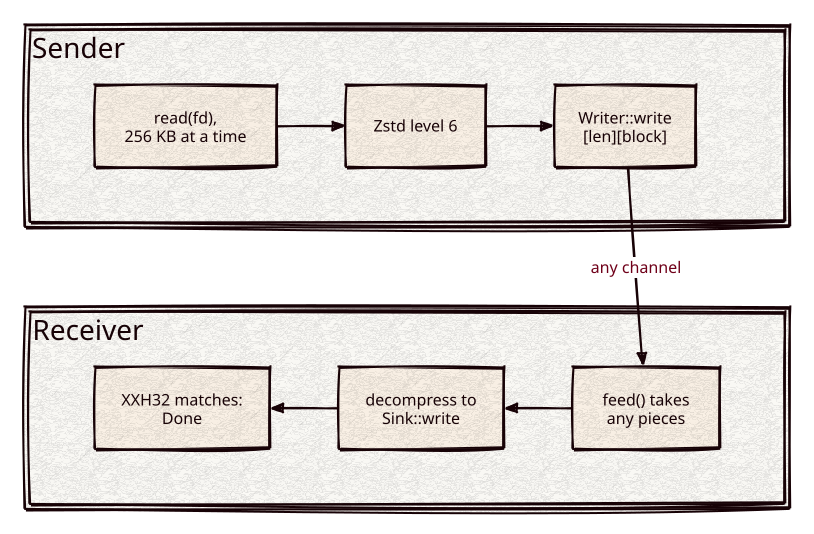

# Architecture

flume is one header (`flume.h`). It sits between a transport (a socket, a connection's write
queue) and the [Kronuz/compressors](https://github.com/Kronuz/compressors) buffer-core
codecs, and owns the three things a file transfer needs that a buffer codec does not: reading
the source in bounded chunks, framing the compressed output so the reader knows where each
block and the whole transfer end, and an end-to-end integrity check.



The source is [docs/flume.d2](docs/flume.d2).

## Dependencies

**[compressors](https://github.com/Kronuz/compressors)** (the Zstd/LZ4 buffer-core plus
the vendored XXH32 used for the per-frame integrity check), pulled in by CMake
`FetchContent`; otherwise header-only. The **channel** (how bytes actually move) and the
**codec choice** are injected by the caller, not dependencies — see
[The codec seam](#the-codec-seam).

## The layering

```
   your transport            flume                     compressors
  ----------------      -----------------          -------------------
   socket / buffer  <->  Sender / Receiver   <->    compress_zstd(view)
   (Writer / Sink)       + framing + XXH32          (buffer-core codec)
```

compressors is deliberately **buffer-core only** (it compresses an in-memory `string_view`);
its own docs push fd-streaming out to "the transport layer." flume *is* that layer. This keeps
the split clean: the codec knows nothing about files or sockets, and flume knows nothing about
entropy coding.

## The frame

```
[len_1][block_1] [len_2][block_2] ... [len=0] [xxh32]
```

- `len` is `serialise_length()`, a byte-oriented varint (a byte < 255 is the value; 0xff
  introduces a base-128 continuation). Vendored in the header, byte-compatible with the rest
  of the Kronuz libraries.
- `block_i` is `codec::compress(chunk_i)`, where `chunk_i` is up to `DEFAULT_BLOCK_SIZE`
  (256 KB) read from the fd. Each block is an independent codec frame, so the reader
  decompresses it standalone; Zstd records the content size in its frame, so no separate
  uncompressed-length is sent.
- The zero-length block is the terminator; the varint after it is the XXH32 digest of the
  whole *uncompressed* stream (seed `0xCEED`, the classic connection codec's seed).

## Sender

`Sender<Writer, Codec>::send()` loops: `::read` a chunk, update the running XXH32 over the raw
bytes, `codec::compress` it, and write `[len][block]` to the `Writer`. At EOF it writes the
`[0]` terminator and the `[xxh32]` footer. Memory is one read chunk plus one compressed block
-- independent of file size. Any short/failed `Writer::write` aborts with `false`.

## Receiver

`Receiver<Sink, Codec>::feed(data, n)` is an incremental parser: it appends to an internal
buffer and consumes as many complete frames as it can, returning `NeedMore` when a varint or a
block is only partially present (so a block split across two socket reads, or a varint split
across them, is handled). For each complete block it `codec::decompress`es to the `Sink` and
folds the plaintext into the running XXH32. On the terminator it reads the footer and compares
the digest -- match is `Done`, mismatch is `Error`. A codec that throws on corrupt input is
caught and surfaced as `Error`; corruption is never silently accepted.

The buffer only ever holds the bytes flume has not yet been able to parse, so a well-behaved
feed loop keeps it near one block.

### The cap for untrusted senders

By default the Receiver believes the sender's sizes: it waits for, and buffers, a block of
whatever length the frame declares, and decompresses it to whatever size the codec reports.
A sender can declare a block of a terabyte and send bytes forever, or send a few hundred
bytes that decode to gigabytes, or send a length prefix that never completes.
`Receiver(sink, max_block)` sets a cap, off at 0:

- a declared compressed length above `max_block` is `Error` as soon as the prefix is read,
  before any of the block is awaited;
- a block whose decoded size exceeds `max_block` is `Error`: a codec with
  `decompress(view, max_size)` (`ZstdCodec` has it) refuses the frame from its recorded
  content size before allocating, and any other codec is checked after it decodes;
- a length prefix that is still unparsable at its longest possible length (11 bytes) is
  `Error`, where without a cap it is awaited for ever;
- on `Error` the buffer is released, and later feeds return `Error`.

With a cap the buffer holds at most `max_block`, one length prefix, and the bytes of one
`feed()` call. `max_block_for(block_size)` is the cap that fits a Sender with that block size:
the block plus the most any codec expands incompressible bytes. The cap bounds memory; it does
not authenticate the sender.

## The codec seam

`Codec` is a compile-time policy: `compress(string_view) -> string` and
`decompress(string_view) -> string`. `ZstdCodec` is the default and the only one in `flume.h`
(so a Zstd-only consumer needs neither lz4 nor zlib on the include path). An `Lz4Codec` or
`DeflateCodec` is a three-line struct over `compress_lz4` / `compress_deflate` once you include
that compressors header -- used in `benchmarks/bench.cc` for the comparison, and available for
a peer that only speaks the old codec.

## Not in scope

flume frames *one* transfer. Multiplexing several files on one connection, the message type
that precedes a transfer (the app's `FILE_FOLLOWS`-style tag), retry/resume, and the socket
I/O itself are the caller's -- flume gives you the `Writer`/`Sink` seams to wire them.
