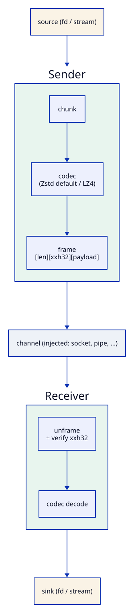

# flume

[](https://github.com/Kronuz/flume/actions/workflows/ci.yml)
[](LICENSE)


Stream a file down any byte channel in C++20: compressed, framed, checksummed, and
in bounded memory. Feed a file in one end; it comes out the other end smaller and
intact. A flume is the wooden channel that floats logs downstream.



## ✨ Highlights

- 🌊 **Bounded memory**: 256 KB blocks, whatever the file size.
- 🗜️ **Zstd level 6 by default**: about 48% fewer bytes than LZ4 at 379 MB/s on one
  core; LZ4 and deflate are one-line codec policies away.
- 🛡️ **End-to-end integrity**: an XXH32 over the uncompressed bytes catches a flipped
  byte or a truncation.
- 🔌 **Any transport**: you supply the `Writer` (socket, Asio, a reply buffer); the
  `Receiver` accepts bytes in whatever pieces they arrive.

## 📦 Installation

Requires a C++20 compiler and CMake 3.14 or newer; the Zstd, LZ4, and zlib
development libraries for [compressors](https://github.com/Kronuz/compressors). CI
builds it on Linux (x86_64, arm64), macOS (arm64, x86_64), and FreeBSD, plus ASan,
UBSan, and TSan builds.

```cmake
include(FetchContent)
FetchContent_Declare(flume
  GIT_REPOSITORY https://github.com/Kronuz/flume.git
  GIT_TAG        main)
FetchContent_MakeAvailable(flume)

target_link_libraries(my_app PRIVATE flume::flume)
```

On macOS, configure with `-DCMAKE_PREFIX_PATH="$(brew --prefix)"` so CMake finds the
keg-only Homebrew compression libraries.

## 🚀 Quick start

```cpp
#include "flume.h"

#include <unistd.h>

struct FdWriter {   // the Sender's output: any channel
	int fd;
	bool write(std::string_view v) { return ::write(fd, v.data(), v.size()) == ssize_t(v.size()); }
};
struct FdSink {     // the Receiver's output: the reconstructed file
	int fd;
	bool write(const char* d, std::size_t n) { return ::write(fd, d, n) == ssize_t(n); }
};

bool send_file(int file_fd, int socket_fd) {
	FdWriter w{socket_fd};
	return flume::Sender<FdWriter>(w, file_fd).send();
}

bool receive_file(int socket_fd, int out_fd) {
	FdSink sink{out_fd};
	flume::Receiver<FdSink> receiver(sink);
	using Status = flume::Receiver<FdSink>::Status;
	char buf[64 * 1024];
	for (ssize_t n; (n = ::read(socket_fd, buf, sizeof buf)) > 0;) {
		auto st = receiver.feed(buf, n);
		if (st == Status::Done) return true;      // checksum verified
		if (st == Status::Error) return false;    // corrupt or truncated
	}
	return false;
}
```

Production writers must loop on short writes. `examples/pipe_file.cc` sends an 8 MB
file over a `socketpair` and checks it arrives byte-identical.

## 🧩 The frame

```
[len_1][block_1] [len_2][block_2] ... [0] [xxh32 of the uncompressed bytes]
```

Each length is a varint, and a zero length ends the transfer. The Zstd level is not
part of the format: any level decodes with any decoder. The codec is part of it.

## 🎯 When to use it

- ✅ Shipping whole files between processes or hosts: replication, snapshots, backups.
- ❌ Several files on one connection, or resume after a drop: flume frames one
  transfer and leaves those to the caller.

## 📚 Documentation

- [ARCHITECTURE.md](ARCHITECTURE.md): the layering, the frame, Sender and Receiver,
  and the codec seam.
- [docs/BENCHMARKS.md](docs/BENCHMARKS.md): codecs and levels compared, and why
  level 6.
- [AGENTS.md](AGENTS.md): repository map and invariants.

## 🛠️ Building and testing

```sh
cmake -B build -DCMAKE_BUILD_TYPE=Release -DCMAKE_PREFIX_PATH="$(brew --prefix)"
cmake --build build && ctest --test-dir build
./build/flume_bench
```

## 🤝 Contributing

Issues and pull requests are welcome. Read [AGENTS.md](AGENTS.md) first. CI must
pass on every platform.

## 📄 License

MIT, Copyright (c) 2026 Germán Méndez Bravo (Kronuz). See [LICENSE](LICENSE).
