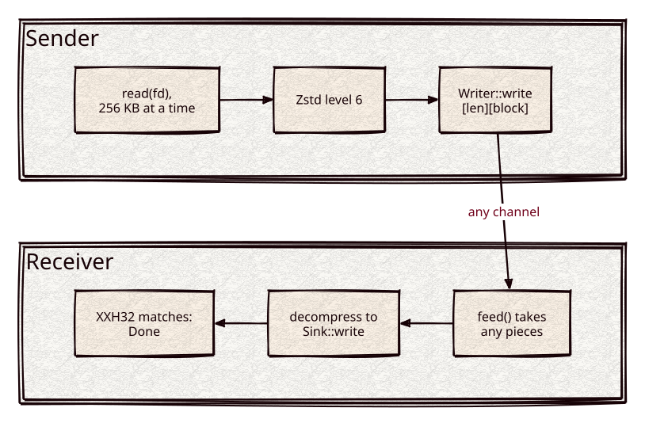

# flume

Part of [Kronuz C++ Libraries](https://github.com/Kronuz/cpp-libraries), a collection of small, reusable C++ libraries.

[](https://github.com/Kronuz/flume/actions/workflows/ci.yml)
[](LICENSE)


Header-only file transfer for C++20: stream a file over any byte channel as framed Zstd blocks with an end-to-end checksum.
The Sender reads the file 256 KB at a time, so its memory does not grow with
the file, and the Receiver accepts bytes in whatever pieces the channel
delivers. Reach for it to ship whole files between processes or hosts:
replication, snapshots, backups. A flume is the wooden channel that floats logs
downstream.



## ✨ Highlights

- **Bounded sender memory.** One 256 KB read buffer and one compressed block,
  whatever the file size.
- **Zstd level 6 by default.** On the benchmark's 32 MiB JSON corpus that is a
  15.1x ratio against 7.9x for LZ4. The level is not part of the wire format:
  any `ZstdCodec<N>` output decodes with any Zstd decoder.
- **End-to-end integrity.** An XXH32 over the uncompressed bytes catches a
  flipped byte or a truncation, and a codec that throws on corrupt input becomes
  `Status::Error`.
- **Any transport.** The caller supplies the `Writer` and the `Sink`;
  `Receiver::feed` handles a block or a length split across reads.
- **A small frame.** `[len][block] ... [0][xxh32]`, with varint lengths; a zero
  length ends the transfer.
- **Pluggable codec.** The codec is a template policy with `compress` and
  `decompress`; an LZ4 or deflate policy is three lines over
  [compressors](https://github.com/Kronuz/compressors).
- **Clean hand-off.** After `Done`, `leftover()` holds any bytes fed past the
  footer, for a caller that carries more on the same channel.

## 🚀 Quick start

```cpp
#include "flume.h"

#include <algorithm>
#include <cstdio>
#include <string>
#include <string_view>

struct Channel {  // the Sender's Writer: a socket in real use, a string here
	std::string bytes;
	bool write(std::string_view v) { bytes.append(v); return true; }
};

struct File {  // the Receiver's Sink: the rebuilt file
	std::string data;
	bool write(const char* d, std::size_t n) { data.append(d, n); return true; }
};

int main() {
	std::FILE* f = std::tmpfile();
	for (int i = 0; i < 100000; ++i)
		std::fprintf(f, "GET /index.html 200 %d\n", i % 7);
	std::fflush(f);
	long size = std::ftell(f);
	std::rewind(f);

	Channel channel;
	flume::Sender<Channel> sender(channel, fileno(f));
	if (!sender.send())
		return 1;

	File out;
	flume::Receiver<File> receiver(out);
	using Status = flume::Receiver<File>::Status;
	Status st = Status::NeedMore;
	for (std::size_t at = 0; at < channel.bytes.size() && st == Status::NeedMore; at += 1000) {
		std::size_t n = std::min<std::size_t>(1000, channel.bytes.size() - at);
		st = receiver.feed(channel.bytes.data() + at, n);  // bytes arrive in any pieces
	}
	std::printf("%ld bytes, %zu on the wire, %s\n", size, channel.bytes.size(),
	            st == Status::Done ? "checksum ok" : "corrupt");
	// 2200000 bytes, 758 on the wire, checksum ok (zstd 1.5.7)
}
```

A socket `Writer` loops on short writes;
[`examples/pipe_file.cc`](examples/pipe_file.cc) sends an 8 MB file over a
`socketpair` that way and checks it arrives byte-identical.

## 📦 Installation

Requires a C++20 compiler and CMake 3.16 or newer. It fetches
[compressors](https://github.com/Kronuz/compressors), which needs zlib and uses
the system Zstd and LZ4 when present (fetching them otherwise). CI builds it on
Linux (x86_64, arm64), macOS (arm64, x86_64), and FreeBSD, plus ASan, UBSan, and
TSan builds.

```cmake
include(FetchContent)
FetchContent_Declare(flume
  GIT_REPOSITORY https://github.com/Kronuz/flume.git
  GIT_TAG        3a49d36afecde02d8bce92588930835b020e6267)  # or main for the tip
FetchContent_MakeAvailable(flume)

target_link_libraries(my_app PRIVATE flume::flume)
```

```cpp
#include "flume.h"
```

On macOS with Homebrew, configure with `-DCMAKE_PREFIX_PATH="$(brew --prefix)"`
so CMake finds the compression libraries.

## 🎯 When to use it

Use it to move whole files between processes or hosts over a channel you already
have: a socket, a pipe, or a connection's write queue.

Not for:

- **Several files, retries, or resume.** flume frames one transfer; multiplexing,
  the message that announces a file, and resuming after a drop are the
  caller's.
- **Untrusted senders.** XXH32 detects accidents, not tampering. By default the
  Receiver buffers a block of whatever length the frame declares and
  decompresses it without a size cap, so a sender can make it hold or allocate
  as much as it likes. `Receiver(sink, max_block)` is the opt-in cap: a longer
  declared block, a block that decodes to more, or a length prefix that cannot
  complete is `Status::Error`. Size it with `flume::max_block_for(block_size)`;
  it bounds memory, not who is talking.
- **Acting on data before `Done`.** The Sink receives each block as it
  decompresses; only `Status::Done` says the whole file matched its checksum.
- **Sources without a file descriptor.** The Sender reads with POSIX `::read`.

## 📚 Documentation

- [ARCHITECTURE.md](ARCHITECTURE.md): the layering, the frame, Sender and
  Receiver, and the codec seam.
- [docs/BENCHMARKS.md](docs/BENCHMARKS.md): codecs and Zstd levels compared on
  the benchmark corpus.
- [AGENTS.md](AGENTS.md): repository map and invariants.
- [CHANGELOG.md](CHANGELOG.md): dated changes.
- [Catalog entry](https://github.com/Kronuz/cpp-libraries/blob/main/AGENTS.md#flume)
  in Kronuz C++ Libraries.

## 🛠️ Building and testing

```sh
cmake -B build
cmake --build build
ctest --test-dir build
./build/flume_bench
```

The tests, `flume_pipe_file`, and `flume_bench` build whenever flume is the
top-level project.

## 🤝 Contributing

Issues and pull requests are welcome. Read [AGENTS.md](AGENTS.md) and the
catalog's [rules of engagement](https://github.com/Kronuz/cpp-libraries/blob/main/AGENTS.md#rules-of-engagement)
first; CI must pass on every platform.

## 📄 License

MIT, Copyright (c) 2026 Germán Méndez Bravo (Kronuz). See [LICENSE](LICENSE).
